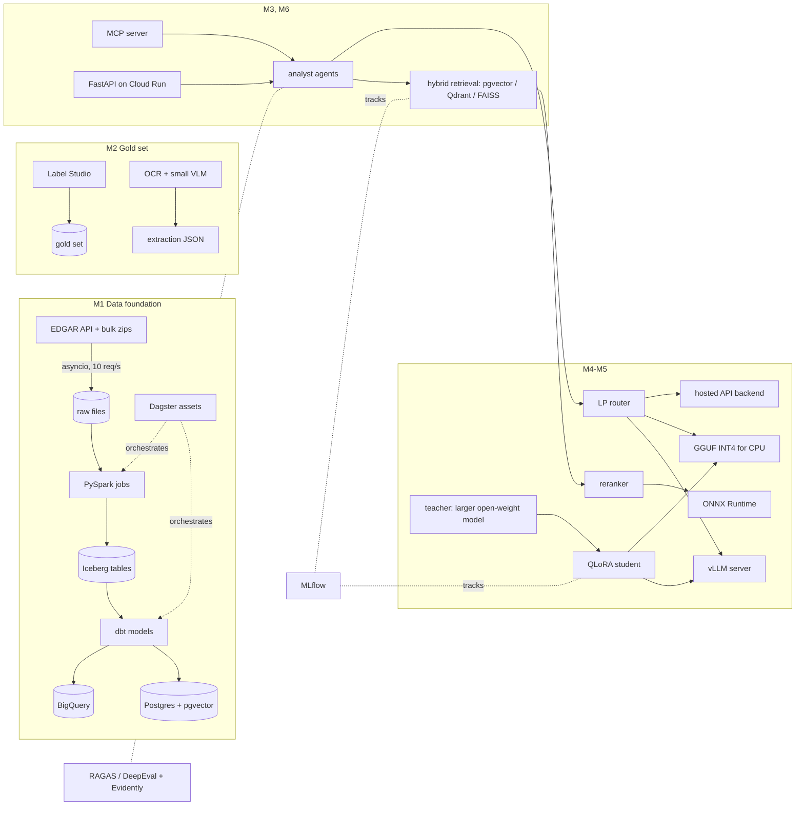

# FilingLens: specification

FilingLens reads US public-company filings from SEC EDGAR and answers analyst questions about them with cited numbers. It fine-tunes and serves its own small extraction model, and measures every model choice it makes.

This spec is the source of truth for the build. Work one milestone at a time, and finish each milestone's "Done when" list before starting the next.

---

## 1. What it does

An analyst asks, for example, "How did Delta's fuel-cost risk language change between 2019 and 2024, and what happened to its operating margin?" FilingLens then:

1. finds the right sections of the right filings (Item 1A Risk Factors, Item 7 MD&A);
2. pulls the matching numbers from the SEC's structured financial data;
3. has a small team of agents draft, check the numbers and cite every claim;
4. returns the answer with links to the filing and the exact figures.

FilingLens also offers:

- **Structured extraction:** filing text and PDF tables become JSON fields, for example `{risk_category, severity, first_seen_year}` or a table's rows and columns.
- **Peer recommendations:** "companies whose filings read most like this one", with a reranker on top.
- **An MCP server** so any MCP client can call FilingLens tools.

### Why this data

- **Free and public.** EDGAR is US government data. Respect SEC fair access: **at most 10 requests per second**, and a `User-Agent` header with your name and email. Put the email in `.env`, never in code.
- **Large enough for Spark.** The SEC's Financial Statement Data Sets are quarterly zip files with millions of numeric rows (`sub`, `num`, `tag`, `pre`).
- **Real drift.** Risk-factor language from 2019, 2020 (COVID), 2022 (inflation) and 2024 (AI) differs measurably.

---

## 2. Architecture



**Runs on ($0 throughout):**
- Your laptop (WSL2 Ubuntu; RTX 5070 Laptop GPU, **8 GB VRAM**) for the student model's training and serving. vLLM, AWQ and 4-bit loading are verified working on it.
- **Kaggle** free GPUs (2× T4) for the 7–8B teacher model, which doesn't fit in 8 GB.
- Docker Compose for Postgres/pgvector, Qdrant, MLflow, Label Studio and Jaeger.
- **BigQuery sandbox** (no card) in M1.
- **Cloud Run** during the Google Cloud $300 trial in M5. The trial cannot charge you unless you manually upgrade.
- **Neon** free Postgres (pgvector) as the cloud database.
- **Gemini API free tier** as the hosted model backend.
- **Databricks Free Edition** to rerun the Spark job once.

---

## 3. Repository layout

```
filinglens/
  src/filinglens/
    ingest/        # M1 asyncio EDGAR client, bulk downloader
    spark/         # M1 PySpark jobs -> Iceberg
    features/      # M1 vectorized + Numba ratio features
    extract/       # M2 OCR, VLM table extraction, field extraction, entity resolution
    kg/            # M2 knowledge graph build
    retrieval/     # M3 indexers (pgvector, Qdrant, FAISS), reranker, recommender
    train/         # M4 SFT, distillation, HP search
    serve/         # M5 vLLM client, ONNX reranker, GGUF runner, LP router, cost meter
    agents/        # M6 analyst crew, context builder, guardrails
    mcp_server/    # M6 MCP tools
    api/           # FastAPI app (Cloud Run)
    eval/          # M7 RAGAS/DeepEval suites, drift, fairness slices
  dagster_project/ # M1 asset definitions
  dbt/             # M1 models, tests, docs
  sql/             # hand-written analytics queries with EXPLAIN notes
  notebooks/       # analysis only; never the only copy of logic
  bench/           # committed benchmark outputs (CSV + the command that made them)
  data/            # git-ignored
  docs/            # SPEC, DATA, EXPERIMENTS, MODEL_CARD, LABELING_GUIDE
  tests/
```

---

## 4. Milestones

Each milestone lists what to build and its **Done when** criteria. "Done" always means committed, tested and documented. Numbers come only from a committed command's output.

### M1 Data foundation (25–30 h)

**Build:**
1. **`ingest/edgar_client.py`.** An `asyncio` + `httpx` client with a token-bucket limiter (10 req/s max; aim for 8) and retries with backoff on 429/5xx. It reads `company_tickers.json` and the submissions API, and downloads 10-K HTML for a chosen universe. Start with about 300 companies across 6+ sectors and the years 2018–2025.
2. **Bulk download** of the Financial Statement Data Sets for 2018Q1 to the latest quarter.
3. **`spark/fsds_to_iceberg.py`.** PySpark reads `sub`/`num`/`tag`/`pre`, casts types, dedupes, and writes Iceberg tables partitioned by fiscal year. Use a local Hadoop catalog. Record row counts and runtime.
4. **Rerun the job on Databricks Free Edition** and note the differences. Free Edition limits:
   - It can't download from sec.gov (outbound internet is limited to trusted domains), so **upload** the zip files to a Unity Catalog volume.
   - It can't write to custom storage, so write **Delta** tables there and compare them with your local Iceberg run.
   - Serverless compute, Python/SQL only, a daily quota.
5. **dbt project** (`dbt-bigquery`, plus `dbt-duckdb` locally if you want):
   - staging → intermediate → marts;
   - a star schema with `fct_financials` and `dim_company`, `dim_period`, `dim_tag`;
   - dbt tests (`unique`, `not_null`, `relationships`, accepted ranges) and `dbt docs`.

   **BigQuery sandbox rules (no card):**
   - Use only `table` and `view` materializations: the sandbox has no DML, so `incremental` models and snapshots fail.
   - Load the marts plus a company subset; storage is capped at 10 GB.
   - Tables expire after 60 days, so `dbt build` must recreate everything from scratch in one command.
   - Keep `dbt-duckdb` as the full local copy.
6. **Dagster assets** for download → spark → dbt, including a backfill of one quarter range.
7. **`sql/`: hand-write at least 8 analytics queries**, for example:
   - YoY revenue growth;
   - rank within sector (`RANK() OVER (PARTITION BY sector ...)`);
   - rolling four-quarter sums;
   - first year a tag appears;
   - a gaps-and-islands streak of margin declines;
   - a CTE pipeline;
   - a self-join for peers;
   - a percentile with `PERCENTILE_CONT`.

   For each one, commit the query, an `EXPLAIN` before and after an index or partition change, and the timing.
8. **`features/ratios.py`.** Compute margin, leverage and growth features three ways: pandas `apply`, then vectorized NumPy, then Numba. Benchmark all three.
9. **Terraform** for the BigQuery dataset (`infra/terraform/gcp`), with state in HCP Terraform Free. If the sandbox project refuses the API call, add this step at M5, when the trial billing account exists.

**Done when:**
- [ ] Downloader test proves it never exceeds the rate limit (fake clock).
- [ ] Iceberg tables exist; `docs/DATA.md` lists row counts, partition layout and runtime (local and Databricks).
- [ ] `dbt build` passes in BigQuery; the docs site is generated.
- [ ] 8+ queries in `sql/`, each with EXPLAIN before/after and timing.
- [ ] Ratio benchmark table is in `bench/`.

### M2 Gold set, OCR and extraction (20–25 h)

**Build:**
1. **Write `docs/LABELING_GUIDE.md` first:** the label definitions, edge cases and examples.
2. **Label Studio:** label about 300 risk-factor paragraphs (category and severity) and about 50 table pages (cells).
3. **Check label consistency:** re-label a random 10% a week later and report agreement (Cohen's kappa).
4. **Synthetic data:** generate extra Q&A pairs from filings with an open-weight model. Mark them `synthetic=true`, and never mix them into the test split.
5. **`extract/tables.py`.** Render PDF pages (for example ARS annual-report PDFs, or page images rendered from HTML filings), then run OCR (Tesseract or docTR) plus a small vision-language model (for example a Qwen2-VL / SmolVLM-class model) to output table JSON. Measure cell-level accuracy on the 50 pages.
6. **`extract/fields.py`.** A prompted baseline that extracts risk category, severity and first-seen year to JSON, scored against the gold set (macro F1). This baseline is what M4 must beat.
7. **`extract/entities.py`.** Company entity resolution: match CIK ↔ ticker ↔ name variants, a dedup report, and a small master company table (the MDM idea).
8. **`kg/build.py`.** A knowledge graph of company → subsidiary (Exhibit 21) → officer (cover pages, signatures). Store it as Postgres edge tables (NetworkX for analysis), and report node/edge counts and the top-degree nodes.

**Done when:**
- [ ] Gold set exported with train/dev/test splits (test is never used for prompts or training).
- [ ] Kappa reported; the labeling guide is committed.
- [ ] Table-extraction accuracy and baseline extraction F1 are in `docs/EXPERIMENTS.md`.
- [ ] Entity-resolution precision on 100 hand-checked pairs.

### M3 Retrieval, ranking and offline A/B (15–20 h)

**Build:**
1. Chunk sections by item and paragraph, and embed them (an open embedding model, or the Jina API you already use).
2. Index the same chunks in **pgvector**, **Qdrant** and **FAISS**. Compare recall@10 and p95 latency on 100 labeled queries.
3. **Reranker:** add a cross-encoder (for example `bge-reranker-base`) and report NDCG@10 and MRR before and after reranking.
4. **Peer recommender:** combine company embeddings (mean of section embeddings) with financial-ratio similarity. Evaluate against SIC-code peers (hit-rate@5).
5. **Offline A/B:**
   - Run a power analysis to choose the number of queries.
   - Run a paired bootstrap between retrieval variants, reporting effect size and a 95% CI.
   - Log every run to MLflow.

**Done when:**
- [ ] Vector-store comparison table and reranker table are committed.
- [ ] The A/B write-up states the decision and why.

### M4 Fine-tune and distill (20–25 h)

**Build:**
1. **Pick the models:**
   - Student: a ~1.5–1.7B instruct model with a permissive license, for example Qwen2.5-1.5B-Instruct or Qwen3-1.7B (Apache-2.0). **Check the model card's license.**
   - Teacher: a 7–8B open-weight instruct model in AWQ 4-bit.
   - Do **not** train on a hosted API's outputs (Gemini included) unless the provider's terms allow it. Gemini is only the router's hosted backend in M5.
2. **Distillation on Kaggle** (free, about 30 GPU-hours a week; phone verification needed):
   - Choose the **"GPU T4 ×2"** accelerator (recent vLLM doesn't support the P100). Use `quantization="awq"`, because Marlin kernels need Ampere or newer.
   - The teacher labels the unlabeled paragraphs in batches. Save the labels as a Kaggle dataset and download them.
   - Filter them by confidence and by agreement with heuristics.
   - Fallback if vLLM won't start there: transformers + bitsandbytes 4-bit (slower).
3. **QLoRA SFT** of the student on your laptop with PEFT/TRL, on gold-train plus the filtered teacher labels.
   - 8 GB VRAM budget: 4-bit base, LoRA rank 8–16, sequence length ≤ 2,048, gradient checkpointing on, batch size 1–4 with gradient accumulation.
   - Record peak VRAM.
   - If a run won't fit, run that one on Kaggle and note it.
4. **Ablations:** gold only, teacher only, and both, plus LoRA rank 8 vs 16 and two learning rates. Add a small hyperparameter search (Optuna) and log all of it to MLflow.
5. **Optional:** DPO on 200 preference pairs (good vs bad extraction) and report whether it helps.
6. **Register the best model** in the MLflow registry with its config and data version.

**Done when:**
- [ ] One MLflow comparison: base prompted vs teacher vs fine-tuned student on the **test** split (macro F1, JSON-valid rate).
- [ ] Training curves and VRAM peak are recorded.
- [ ] The model and adapter are in the registry; `docs/EXPERIMENTS.md` is updated.

### M5 Serve, optimize and route (15–20 h)

**Build:**
1. **Serve the student with vLLM** (WSL2, laptop GPU; verified working with vLLM 0.33 + CUDA 13.2; see `docs/SETUP_WSL.md`).
   - Run vLLM from a `.py` file with an `if __name__ == "__main__":` guard (WSL uses the spawn start method).
   - Set `gpu_memory_utilization` to leave room for the display.
2. **Quantization:**
   - BF16 vs **AWQ INT4** (`awq_marlin`, verified on this GPU) vs **FP8** (try it; Blackwell supports it) vs GPTQ (try it).
   - Plus a GGUF Q4_K_M build run with llama.cpp on CPU as the "edge" target.
   - A format that fails on this GPU goes in the table as "not supported on sm_120", with the error. That is a finding, not a gap.
   - **Laptop note:** plug in, use the Performance power mode, and record the power mode and GPU temperature with every run.
3. **Export the reranker to ONNX Runtime** and compare its latency with PyTorch.
4. **`bench/serving.csv`.** TTFT, tokens/s, p50/p95 latency at 1/4/16 concurrent requests, VRAM, and the accuracy on the test split for each format.
5. **LP router (`serve/router.py`):** decide which backend handles each request class (extraction, short Q&A, long synthesis).
   - Backends: vLLM student, GGUF CPU, and the **Gemini API free tier** (Flash-Lite). Its free-tier rate limits are a real constraint: put them in the LP as a capacity limit.
   - Use `scipy.optimize.linprog` or PuLP to minimize expected cost subject to minimum accuracy, maximum p95 latency and capacity per class.
   - Cost model: use published **list prices** for the hosted model and an electricity/GPU-hour estimate for local backends. Your actual spend is $0; say both plainly.
   - Compare it with a greedy rule.
6. **Cost meter:** record tokens, latency and list-price cost per request, route and user in Postgres (OpenTelemetry span attributes too), and chart it.
7. **Deploy at $0:**
   - The FastAPI app runs on **Cloud Run** under the Google Cloud **$300 trial**. The trial bills nothing unless you upgrade; when it ends after 90 days, workloads stop.
   - It uses **Neon** free Postgres (pgvector) loaded with a demo subset that fits in 1 GB, and calls the Gemini backend.
   - Record a demo video before the trial ends.
   - Optional permanent free demo: a Gradio Space on Hugging Face (free CPU Basic, or ZeroGPU).
   - Local GPU backends are demo-only; say so in the README.

**Done when:**
- [ ] `bench/serving.csv` and a chart are committed, with the exact command used.
- [ ] Router notebook shows constraints, solution and savings vs greedy on the same traffic mix.
- [ ] Cloud Run URL works; teardown steps are in the README.

### M6 Agents and MCP (15–20 h)

**Build:**
1. **Analyst crew** on **one framework you have not used**: LlamaIndex Workflows or CrewAI. LangGraph does not count; you already have it. The crew has four roles:
   - planner: splits the question;
   - retriever: M3 search;
   - numbers checker: every figure must match `fct_financials` or the answer is blocked;
   - writer: cites a filing URL for every claim.
2. **Context builder:** a token-budgeted packer that ranks chunks, dedupes and truncates by section. Chart answer quality vs budget (2k/4k/8k/16k tokens).
3. **MCP server** (official Python SDK) with read-only tools: `search_filings`, `get_financials`, `compare_peers`, `extract_risks`. Write tests for every tool, and record a demo from an MCP client such as Claude Desktop.
4. **Guardrails and red team:** build a prompt-injection set, for example planted instructions in filing text, which is a real attack surface. Run it with promptfoo or garak and report the block rate before and after guardrails.

**Done when:**
- [ ] Task success on 30 analyst questions, scored with a written rubric.
- [ ] MCP demo recorded; tool tests pass.
- [ ] Red-team table committed.

### M7 Evaluation, monitoring and responsible AI (12–16 h)

**Build:**
1. **RAGAS or DeepEval** over the gold Q&A set: faithfulness, answer relevance and context precision. Add a CI job that fails if faithfulness drops by more than 3 points.
2. **Hallucination check:** what share of the figures in answers fail the numbers checker, before and after M6.
3. **Drift:** an Evidently report comparing 2019 vs 2025 risk-factor text features and extraction confidence. Write up which categories drifted.
4. **Fairness slices:** extraction F1 by sector and by company size (market-cap terciles). Explain any gap and what you changed.
5. **Write `docs/MODEL_CARD.md`:** intended use, data, metrics, slices, limits, and "not investment advice".
6. **OpenTelemetry traces** for API → agents → model calls, viewed in Jaeger.

**Done when:**
- [ ] Eval report and CI gate are in place.
- [ ] Drift report HTML, fairness table and model card are committed.

---

## 5. Rules that apply everywhere

- **Measured numbers only.** Every number in the README or docs comes from a committed command's output in `bench/` or an MLflow run. No estimates are written as results.
- **Keep the test split clean.** No prompt tuning on it and no training on it.
- **Licenses.** Record the license of every model and dataset in `docs/DATA.md`.
- **Secrets.** Secrets live in `.env`, which is git-ignored; only `.env.example` is committed.
- **Cost: $0.** Use only the sandbox, free tiers and the trial credit, and never upgrade a trial to paid. Write teardown steps for every cloud resource.
- **Provenance.** Log in `PROVENANCE.md` which parts you hand-wrote and which were AI-assisted, as you go.
